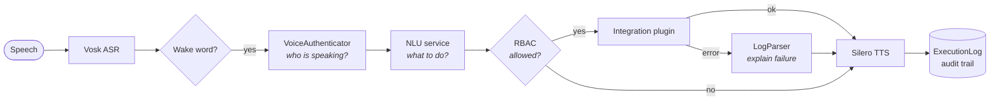

# AutomatedSpeechControl

[](https://github.com/BassKst/AutomatedSpeechControl/actions/workflows/ci.yml)
[](https://www.python.org/downloads/)
[](https://github.com/astral-sh/ruff)
[](LICENSE)

**English** | [Русский](README.ru.md)

Voice-controlled infrastructure assistant. Speak a command, and the system
identifies **who** is speaking by voice, resolves **what** they want with a
two-tier NLU pipeline, checks **whether they are allowed** to do it, and then
provisions real infrastructure through Terraform and Ansible — announcing the
result back by synthesised speech.

> Developed as a graduation thesis project: a voice assistant that lets an
> organisation delegate routine infrastructure tasks to it, with access
> controlled by the speaker's voice.

**Contents:**
[Highlights](#highlights) ·
[Request flow](#how-a-request-flows) ·
[Architecture](#architecture) ·
[Security](#security-model) ·
[Getting started](#getting-started) ·
[Plugins](#writing-your-own-integration) ·
[Development](#development) ·
[Roadmap](#limitations--roadmap)

## Highlights

- **Hexagonal architecture.** The application core knows nothing about
  microphones, Telegram, or HTTP. Everything touches the core through the
  `IAssistantChannel` port and the `BaseIntegration` plugin contract.
- **Voice biometrics with RBAC.** Speakers are identified by a Resemblyzer
  embedding; the matched user's role carries an `access_level` that is compared
  against the level each integration requires.
- **Encrypted biometric storage.** Voice embeddings are Fernet-encrypted at
  rest and decrypted only into an in-memory cache.
- **Two-tier NLU.** Fast deterministic fuzzy matching (rapidfuzz) with an
  optional Ollama/LLM fallback for phrasings the corpus does not cover.
- **Plugin auto-discovery.** Drop a `BaseIntegration` subclass into
  `integrations/plugins/` and it is registered, exposed to the NLU schema, and
  access-controlled automatically.
- **Real deployment automation.** The `deploy_node` plugin drives
  `terraform apply` against Hetzner Cloud and configures the resulting VM with
  an Ansible playbook.
- **TLS between services.** The assistant talks to the NLU microservice over
  HTTPS with certificate verification.

## How a request flows



Long-running integrations are dispatched to a `ThreadPoolExecutor` so the
assistant keeps listening while Terraform works.

## Architecture


### Module map

| Path | Responsibility |
| --- | --- |
| `main.py` | Composition root — wires engines, channel and core by hand |
| `src/assistant_core/` | Application core: orchestration, ASR, TTS, NLU client, biometrics, log analysis |
| `src/assistant_core/interfaces.py` | The `IAssistantChannel` port and the `UserRequest` DTO |
| `src/assistant_core/integrations/` | Plugin base class, registry, entity corpora, plugins |
| `src/assistant_core/database/` | SQLAlchemy models and the persistence service |
| `src/channels/` | Driving adapters (local audio; Telegram is a scaffold) |
| `src/common/` | Cross-cutting config, logging, encryption, audio helpers |
| `src/nlu_server/` | Standalone FastAPI NLU microservice (fuzzy + Ollama) |
| `src/voice_biometrics/` | Interactive CLI for enrolling users and roles |
| `alembic/` | Database migrations |
| `scripts/` | Operational helpers (e.g. Vosk model download) |
| `tests/` | Pytest suite |

## Security model

| Concern | Approach |
| --- | --- |
| Speaker authentication | Cosine similarity between a live Resemblyzer embedding and encrypted stored profiles, with a configurable threshold |
| Authorisation | Role-based `access_level` compared against each integration's required level before execution |
| Biometrics at rest | Fernet symmetric encryption (`common/encryption_service.py`); embeddings never stored in plaintext |
| Service transport | HTTPS with explicit certificate verification (`verify=CERT_PATH`) |
| Secrets | `.env` is gitignored; only `.env.example` is committed. The whole `certs/` directory is gitignored as well, and both files are produced locally by `generate_certs.py` |
| Audit | Every request is written to `execution_logs` with user, transcript, entities, intent, status and response |

Known gaps are listed in [Limitations](#limitations--roadmap).

## Getting started

### Prerequisites

- **Python 3.11+**
- **PortAudio** headers, required to build `PyAudio`:
  - Debian/Ubuntu: `sudo apt-get install portaudio19-dev python3-pyaudio`
  - macOS: `brew install portaudio`
  - Windows: wheels are published on PyPI, no extra steps
- **ffmpeg** (used by `librosa`/`soundfile` for some formats)
- Optional, only for the LLM NLU fallback: **[Ollama](https://ollama.com)** with
  `ollama pull llama3.1:8b`
- Optional, only for the `deploy_node` plugin: **Terraform** and **Ansible**

### Installation

```bash
git clone https://github.com/BassKst/AutomatedSpeechControl.git
cd AutomatedSpeechControl

python -m venv .venv
# Windows:  .venv\Scripts\activate
source .venv/bin/activate

# Core + tests only (fast; no torch/vosk/librosa):
pip install -e ".[dev]"

# Full local stack (audio pipeline + NLU service + enrollment CLI):
pip install -e ".[all]"
```

The dependency extras keep the install small for the common cases:

| Extra | Installs | Needed for |
| --- | --- | --- |
| *(none)* | dotenv, SQLAlchemy, alembic, cryptography, requests, numpy, scipy | Core, migrations, tests |
| `audio` | vosk, PyAudio, sounddevice, soundfile, librosa, torch, Resemblyzer | Running the local voice assistant |
| `nlu` | fastapi, uvicorn, rapidfuzz, psutil | Running the NLU microservice |
| `enrollment` | pyperclip | The voice-enrollment CLI |
| `scheduler` | APScheduler | `common/scheduler.py` |
| `dev` | pytest, ruff, black | Tests and linting |
| `all` | everything above except `dev` | Full local stack |

### Configure the environment

```bash
cp src/common/.env.example src/common/.env
```

Generate a Fernet key for `ENCRYPTION_KEY` (this is **not** the same thing as a
hex token):

```bash
python -c "from cryptography.fernet import Fernet; print(Fernet.generate_key().decode())"
```

| Variable | Example | Purpose |
| --- | --- | --- |
| `ENCRYPTION_KEY` | *(Fernet key)* | Encrypts voice embeddings at rest |
| `WAKE_WORD` | `ассистент` | Phrase that must precede a command |
| `SAMPLE_RATE` | `16000` | Audio sample rate shared by ASR and biometrics |
| `TOP_DB` | `10` | Silence-trim threshold (dB) |
| `VOSK_MODEL_PATH` | `models/vosk-model-small-ru-0.22` | Acoustic model location |
| `NLU_MODE` | `nlu` \| `llama` \| `both` | Fuzzy only, LLM only, or fuzzy-then-LLM |
| `API_HOST` / `PORT` | `localhost` / `8000` | NLU service address (must match the TLS cert) |
| `IGNORE_WHEN_SPEAKING` | `False` | Deaf mode while TTS is playing |
| `IGNORE_UNAUTHORIZED` | `False` | Reject unidentified speakers outright |
| `INTERRUPT_TTS` | `True` | Allow barge-in to stop speech |

### Download the acoustic model

Models are not committed to git:

```bash
python scripts/download_vosk_model.py
```

### Generate TLS certificates

```bash
python generate_certs.py     # writes certs/server.key and certs/server.crt
```

The generated certificate is self-signed for `localhost`, so `API_HOST` must be
`localhost` for certificate verification to succeed.

### Create the database schema

```bash
alembic upgrade head
```

### Enroll a voice profile

Roles and users are managed through an interactive CLI:

```bash
python -m voice_biometrics.main
```

Create a role first (its `access_level` gates integrations), then create a user
and record three phrases to build their embedding.

### Run

Start the NLU service, then the assistant:

```bash
python src/nlu_server/server.py     # terminal 1
python main.py                      # terminal 2
```

Say the wake word followed by a command, for example
*«ассистент, проверь нагрузку на сервер два в германии»*.
Say **«стоп»**, **«отмена»** or **«отключись»** to shut down.

### Troubleshooting

**`No module named 'resemblyzer'`** after a successful install: Resemblyzer
needs `pkg_resources`, removed in setuptools 81. Run `pip install "setuptools<81"`.

**`No module named 'common'`** when running `python main.py`: install the
project first with `pip install -e ".[all]"`.

**Every command fails.** Start the NLU service first and check that `certs/`
exists and `API_HOST=localhost`.

**Nobody is recognised.** Enroll at least one profile with
`python -m voice_biometrics.main`.

## Writing your own integration

Create a file in `src/assistant_core/integrations/plugins/` and subclass
`BaseIntegration`. Discovery, NLU-schema registration and access control are
automatic — no registry edits required.

```python
from assistant_core.integrations.base import BaseIntegration
from assistant_core.integrations.entity_corpus import Corpus, EntityCorpus


class RestartServiceIntegration(BaseIntegration):
    @property
    def intent_name(self) -> str:
        return "restart_service"          # must be unique across plugins

    @property
    def intent_corpus(self) -> list[str]:
        return ["перезапусти сервис", "рестартни службу"]

    @property
    def entity_corpus(self) -> list[Corpus]:
        return [EntityCorpus.region]

    @property
    def is_long_running(self) -> bool:
        return True                       # dispatched to a worker thread

    @property
    def access_level(self) -> int:
        return 10                         # required RBAC level

    def execute(self, entities: dict, context: dict) -> dict:
        return {"status": "success", "message": "Сервис перезапущен"}
```

Returning `{"status": "error", "raw_log": "..."}` routes `raw_log` through
`LogParser`, which converts raw SSH/API output into a short spoken diagnosis.

## Deployment automation

The `deploy_node` plugin shells out to the manifests under
`src/assistant_core/integrations/automation/`:

1. **Terraform** (`terraform/`) provisions a Hetzner Cloud server from `region`
   and `node_name`, exported as `TF_VAR_*`.
2. **Ansible** (`ansible/deploy_node.yml`) installs Docker, renders a Remnawave
   node compose file and environment, and applies UFW rules.

`hcloud_token` is a sensitive Terraform variable and is not stored in the
repository; supply it as `TF_VAR_hcloud_token` or via a backend.

## Development

### Tests

```bash
pip install -e ".[dev]"
pytest
ruff check .
```

Tests cover the modules that need no audio hardware or ML models: config,
log parsing, entity corpora, port contracts, the plugin base class and
encryption.

Pre-commit hooks (ruff plus basic repository checks):

```bash
pip install pre-commit
pre-commit install
```

### Continuous integration

| Job | What it does |
| --- | --- |
| `lint` | `ruff check .` |
| `test` | `pytest` on Python 3.11, 3.12 and 3.13 |
| `package` | builds the wheel and checks that all `src/` packages are included |
| `docker` | builds the NLU image, starts it and waits for a TLS response on `/docs` |

### Docker

Only the NLU service is containerised; the assistant needs a microphone and
runs on the host.

```bash
python generate_certs.py
docker compose up --build nlu
```

The image runs in `NLU_MODE=nlu` (no Ollama inside) as a non-root user.
Certificates are mounted from `./certs`; on Linux the key must be readable by
uid 10001 (`chmod 644 certs/server.key`).

## Project layout

```
.
├── main.py                     # composition root
├── generate_certs.py           # self-signed TLS cert generator
├── pyproject.toml              # metadata, dependencies, pytest/ruff/black config
├── Dockerfile                  # NLU microservice image
├── docker-compose.yaml         # local run for the NLU service
├── alembic.ini  alembic/       # migrations
├── .github/workflows/ci.yml    # lint, test matrix, wheel check, docker smoke test
├── .pre-commit-config.yaml     # ruff + repo hygiene hooks
├── certs/                      # TLS material (gitignored, generated locally)
├── models/                     # Vosk models (gitignored, see scripts/)
├── scripts/                    # operational helpers
├── tests/                      # pytest suite
└── src/
    ├── assistant_core/         # application core
    │   ├── database/           # SQLAlchemy models + persistence
    │   └── integrations/       # plugin framework + automation manifests
    ├── channels/               # driving adapters
    ├── common/                 # config, logging, encryption, audio
    ├── nlu_server/             # FastAPI NLU microservice
    └── voice_biometrics/       # enrollment CLI
```

## Limitations & roadmap

This is a thesis project, not a production system. Known issues:

- `deploy_node` has not been tested end-to-end: entity validation, region
  code mapping (`DE` vs `fsn1`) and subprocess timeouts need work.
- `TelegramChannel` is a stub.
- The NLU `/call` endpoint has no authentication.
- Biometric matching has no anti-spoofing check.
- Short synonyms can match inside longer words (`"раз"` in `"разверни"`).
- `common/scheduler.py` and the `Command`/`Settings` models are unused.

Next steps:
1. Fix the `deploy_node` path.
2. Authenticate the NLU service.
3. Add tests for the NLU engine, plugin manager and database layer.
4. Implement the Telegram channel.
5. Record a demo for the README.

## License

[MIT](LICENSE)
