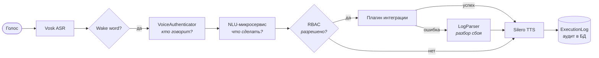

# AutomatedSpeechControl

[](https://github.com/BassKst/AutomatedSpeechControl/actions/workflows/ci.yml)
[](https://www.python.org/downloads/)
[](https://github.com/astral-sh/ruff)
[](LICENSE)

[English](README.md) | **Русский**

Голосовой ассистент для управления серверной инфраструктурой. Вы произносите команду вслух — система идентифицирует говорящего **по голосу** (голосовая биометрия), распознает **намерение и сущности** через двухуровневый NLU-пайплайн, проверяет **права доступа** (RBAC) и запускает автоматическое развертывание инфраструктуры через Terraform и Ansible, озвучивая результат синтезированной речью.

> Проект выполнен в рамках выпускной квалификационной работы (ВКР): голосовой ассистент, которому организация может делегировать рутинные инфраструктурные задачи, а доступ к ним определяется голосом говорящего.

**Содержание:**
[Особенности](#ключевые-особенности) ·
[Поток запроса](#схема-прохождения-запроса) ·
[Архитектура](#архитектура-системы) ·
[Безопасность](#модель-безопасности) ·
[Быстрый старт](#быстрый-старт) ·
[Плагины](#создание-собственных-интеграций-плагинов) ·
[Разработка](#разработка-и-cicd) ·
[Планы](#ограничения-и-планы-развития)

## Ключевые особенности

- **Гексагональная архитектура (Ports & Adapters).** Ядро приложения ничего не знает о микрофонах, Telegram или HTTP. Любое взаимодействие с ядром происходит через входящий порт `IAssistantChannel` и контракт плагинов `BaseIntegration`.
- **Голосовая биометрия и ролевой доступ (RBAC).** Дикторы идентифицируются по векторным эмбеддингам голоса (Resemblyzer); роль пользователя имеет числовой `access_level`, сопоставляемый с уровнем допуска, требуемым конкретной интеграцией.
- **Шифрование биометрических данных.** Векторы голоса шифруются алгоритмом Fernet (AES-128-CBC + HMAC) при сохранении в SQLite/PostgreSQL и расшифровываются исключительно в оперативную память.
- **Двухуровневый NLU (Natural Language Understanding).** Быстрое детерминированное сопоставление (rapidfuzz) с автоматическим фолбэком на локальную нейросеть (Ollama/LLaMA) для нестандартных формулировок.
- **Автообнаружение плагинов (Plugin Auto-discovery).** Достаточно создать класс-наследник `BaseIntegration` в папке `integrations/plugins/` — он автоматически зарегистрируется в системе, добавит свои сущности в схему NLU и защитится ролевым доступом.
- **Реальная автоматизация инфраструктуры.** Плагин `deploy_node` запускает `terraform apply` для аренды облачных серверов в Hetzner Cloud и настраивает их с помощью Ansible Playbook.
- **Взаимный TLS (HTTPS) между микросервисами.** Ассистент взаимодействует с NLU-сервером по защищенному протоколу HTTPS с валидацией сертификатов.

## Схема прохождения запроса



Длительные сценарии автоматизации отправляются в отдельный `ThreadPoolExecutor`, благодаря чему ассистент продолжает слушать команды и не зависает во время работы Terraform/Ansible.

## Архитектура системы

```
+-------------------------------------------------------------------+
|                        Входящие адаптеры                          |
|   LocalAudioChannel (микрофон/динамики)  TelegramChannel (каркас) |
+---------------------------------+---------------------------------+
                                  |  IAssistantChannel  (порт)
                                  |  listen/reply/interrupt/close
+---------------------------------v---------------------------------+
|                     AssistantApplication  (ядро)                  |
|                                                                   |
|  1. VoiceAuthenticator   ID диктора -> пользователь + access_level|
|  2. nlu_client           HTTPS -> nlu_server (интент, сущности)   |
|  3. IntegrationManager   реестр плагинов + контроль прав RBAC     |
|  4. LogParser            сырой лог -> краткий понятный диагноз    |
|  5. db_service           журнал аудита в ExecutionLog             |
+------------+-----------------------------------+------------------+
             |                                   |
+------------v--------------+   +----------------v------------------+
|     Исходящие адаптеры    |   |       Интеграции (плагины)        |
|  ASREngine      (Vosk)    |   |  check_load    deploy_node        |
|  TTSEngine      (Silero)  |   +----------------+------------------+
|  encryption_service       |                    | subprocess
|  audio_utils    (librosa) |   +----------------v------------------+
+---------------------------+   | Terraform (Hetzner) -> Ansible    |
                                | -> VPN-узел (Remnawave + Docker)  |
                                +-----------------------------------+
```

### Карта модулей

| Путь | Назначение |
| --- | --- |
| `main.py` | Точка входа (Composition root) — ручная инициализация движков, каналов и зависимостей ядра |
| `src/assistant_core/` | Ядро приложения: оркестрация, распознавание, синтез речи, NLU-клиент, биометрия, аудит |
| `src/assistant_core/interfaces.py` | Порт `IAssistantChannel` и контракт `UserRequest` DTO |
| `src/assistant_core/integrations/` | Базовый класс плагинов, динамический реестр, словари сущностей |
| `src/assistant_core/database/` | Модели SQLAlchemy и сервис персистентности |
| `src/channels/` | Входящие адаптеры (локальное аудио; каркас Telegram-канала) |
| `src/common/` | Сквозные компоненты: загрузка конфигурации, логирование, шифрование, работа со звуком |
| `src/nlu_server/` | Микросервис NLU на FastAPI (быстрый fuzzy matching + Ollama LLM) |
| `src/voice_biometrics/` | Интерактивная консоль для регистрации ролей, пользователей и записи голоса |
| `alembic/` | Миграции базы данных |
| `scripts/` | Вспомогательные скрипты (например, загрузка модели Vosk) |
| `tests/` | Набор тестов Pytest |

## Модель безопасности

| Область | Реализация |
| --- | --- |
| Аутентификация диктора | Косинусное сходство эмбеддинга Resemblyzer с зашифрованными профилями дикторов по порогу чувствительности |
| Авторизация | Сравнение числового `access_level` роли пользователя с уровнем допуска вызываемого плагина |
| Хранение биометрии | Симметричное шифрование Fernet (`common/encryption_service.py`); векторы никогда не пишутся в БД в открытом виде |
| Межсервисный транспорт | HTTPS со строгой проверкой сертификата (`verify=CERT_PATH`) |
| Секреты | Файл `.env` исключен из git; в репозитории хранится только `.env.example`. Каталог `certs/` также исключен и создается скриптом `generate_certs.py` |
| Аудит | Каждая команда фиксируется в таблице `execution_logs` с указанием пользователя, текста, параметров, статуса и ответа |

## Быстрый старт

### Требования к окружению

- **Python 3.11+**
- Заголовочные файлы **PortAudio** (требуются для сборки библиотеки `PyAudio`):
  - Debian/Ubuntu: `sudo apt-get install portaudio19-dev python3-pyaudio`
  - macOS: `brew install portaudio`
  - Windows: колеса (`wheels`) публикуются на PyPI в скомпилированном виде, дополнительных действий не требуется
- **ffmpeg** (используется библиотеками `librosa`/`soundfile` для конвертации аудио)
- Опционально (для фолбэка на LLM в NLU): **[Ollama](https://ollama.com)** с моделью `ollama pull llama3.1:8b`
- Опционально (для плагина `deploy_node`): установленные **Terraform** и **Ansible**

### Установка

```bash
git clone https://github.com/BassKst/AutomatedSpeechControl.git
cd AutomatedSpeechControl

python -m venv .venv
# Windows:  .venv\Scripts\activate
source .venv/bin/activate

# Только ядро и тесты (быстрая установка без тяжелых torch/vosk/librosa):
pip install -e ".[dev]"

# Полный локальный стек (голосовой ассистент + микросервис NLU + утилита биометрии):
pip install -e ".[all]"
```

Проект использует опциональные зависимости (`extras`) в `pyproject.toml`:

| Extra | Состав | Где требуется |
| --- | --- | --- |
| *(базовый)* | dotenv, SQLAlchemy, alembic, cryptography, requests, numpy, scipy | Ядро, миграции, легковесные тесты |
| `audio` | vosk, PyAudio, sounddevice, soundfile, librosa, torch, Resemblyzer | Запуск голосового контура на хосте |
| `nlu` | fastapi, uvicorn, rapidfuzz, psutil | Запуск микросервиса NLU |
| `enrollment` | pyperclip | Интерактивная консоль регистрации голоса |
| `scheduler` | APScheduler | Модуль планировщика `common/scheduler.py` |
| `dev` | pytest, ruff, black | Тестирование и линтинг |
| `all` | все вышеперечисленное (кроме `dev`) | Полный локальный запуск |

### Настройка переменных окружения

```bash
cp src/common/.env.example src/common/.env
```

Сгенерируйте Fernet-ключ для `ENCRYPTION_KEY`:

```bash
python -c "from cryptography.fernet import Fernet; print(Fernet.generate_key().decode())"
```

| Переменная | Пример | Назначение |
| --- | --- | --- |
| `ENCRYPTION_KEY` | *(Fernet-ключ)* | Симметричный ключ для шифрования векторов биометрии в БД |
| `WAKE_WORD` | `ассистент` | Фраза активации, предшествующая голосовой команде |
| `SAMPLE_RATE` | `16000` | Частота дискретизации аудио (общая для Vosk и биометрии) |
| `TOP_DB` | `10` | Порог обрезки тишины в аудиосигнале (дБ) |
| `VOSK_MODEL_PATH` | `models/vosk-model-small-ru-0.22` | Путь к распакованной акустической модели Vosk |
| `NLU_MODE` | `nlu` \| `llama` \| `both` | Режим работы: fuzzy-поиск, только LLM, или сначала fuzzy, затем LLM |
| `API_HOST` / `PORT` | `localhost` / `8000` | Адрес NLU-сервера (должен соответствовать TLS-сертификату) |
| `IGNORE_WHEN_SPEAKING` | `False` | Игнорировать входящий звук во время воспроизведения ответа (TTS) |
| `IGNORE_UNAUTHORIZED` | `False` | Сразу отклонять команды от нераспознанных дикторов |
| `INTERRUPT_TTS` | `True` | Разрешать прерывать голосовой ответ новой фразой (Barge-in) |

### Загрузка акустической модели речи

Вес моделей составляет десятки мегабайт, поэтому они не хранятся в Git:

```bash
python scripts/download_vosk_model.py
```

### Генерация TLS-сертификатов

```bash
python generate_certs.py     # создаст certs/server.key и certs/server.crt
```

Сертификат выпускается самоподписанным для домена `localhost`, поэтому переменная `API_HOST` также должна быть `localhost` для успешной верификации TLS-цепочки.

### Инициализация базы данных

```bash
alembic upgrade head
```

### Регистрация голосового профиля пользователя

Управление ролями и голосовыми слепками выполняется через консоль:

```bash
python -m voice_biometrics.main
```

1. Сначала создайте роль (ее параметр `access_level` определяет права на запуск интеграций).
2. Затем создайте пользователя и запишите 3 контрольные фразы в микрофон для формирования голосового вектора.

### Запуск системы

Запустите микросервис NLU, а затем основного ассистента:

```bash
python src/nlu_server/server.py     # Терминал 1
python main.py                      # Терминал 2
```

Произнесите фразу активации и команду, например:  
*«ассистент, проверь нагрузку на сервер два в германии»*.  
Для завершения диалога скажите: **«стоп»**, **«отмена»** или **«отключись»**.

---

### Решение возможных проблем (Troubleshooting)

- **`ModuleNotFoundError: No module named 'resemblyzer'`** (или `webrtcvad`) при успешной установке `pip install -e ".[all]"`:  
  Библиотека `Resemblyzer` обращается к устаревшему `pkg_resources`, который был полностью удален в `setuptools>=81`. В `pyproject.toml` в секции `audio` зафиксирован пин `setuptools<81`. Если вы запускаете в старом виртуальном окружении, выполните:
  ```bash
  pip install "setuptools<81"
  ```
- **`ModuleNotFoundError: No module named 'common'` / `'assistant_core'`** при запуске `python main.py`:  
  Исходный код организован по схеме `src-layout`. Пакеты должны быть зарегистрированы через `pip install -e ".[all]"`.
- **Ассистент запускается, но команды падают с ошибкой сети:**  
  `main.py` выступает клиентом к микросервису NLU (`https://localhost:8000`). Убедитесь, что сервер NLU запущен (`python src/nlu_server/server.py` или `docker compose up nlu`), папка `certs/` содержит сертификаты и переменная `API_HOST=localhost`.
- **ASR не может загрузить модель:**  
  Выполните загрузку модели командой `python scripts/download_vosk_model.py`.
- **Диктор не распознается:**  
  Профили хранятся в зашифрованном виде в `assistant.db`. Пока в системе нет ни одного зарегистрированного пользователя через `python -m voice_biometrics.main`, `VoiceAuthenticator` не сможет сопоставить диктора.

## Создание собственных интеграций (плагинов)

Для добавления новой команды создайте `.py` файл в каталоге `src/assistant_core/integrations/plugins/` и унаследуйте класс от `BaseIntegration`. Регистрация в NLU и проверка прав произойдут автоматически:

```python
from assistant_core.integrations.base import BaseIntegration
from assistant_core.integrations.entity_corpus import Corpus, EntityCorpus

class RestartServiceIntegration(BaseIntegration):
    @property
    def intent_name(self) -> str:
        return "restart_service"          # Уникальный идентификатор команды

    @property
    def intent_corpus(self) -> list[str]:
        return ["перезапусти сервис", "рестартни службу"]

    @property
    def entity_corpus(self) -> list[Corpus]:
        return [EntityCorpus.region]

    @property
    def is_long_running(self) -> bool:
        return True                       # Выполнять в фоновом пуле потоков

    @property
    def access_level(self) -> int:
        return 10                         # Минимальный RBAC-уровень доступа

    def execute(self, entities: dict, context: dict) -> dict:
        return {"status": "success", "message": "Сервис успешно перезапущен"}
```

Если вернуть `{"status": "error", "raw_log": "..."}`, необработанный вывод команды автоматически поступит в `LogParser`, который превратит стек-трейс или лог Ansible в понятное голосовое объяснение.

---

## Автоматизация инфраструктуры

Плагин `deploy_node` запускает скрипты автоматизации из каталога `src/assistant_core/integrations/automation/`:

1. **Terraform** (`terraform/`) — создание облачного сервера в Hetzner Cloud на основе параметров `region` и `node_name` (передаются через переменные окружения `TF_VAR_*`).
2. **Ansible** (`ansible/deploy_node.yml`) — установка Docker, развертывание контейнеров Remnawave VPN-узла и настройка сетевого экрана UFW.

Токен Hetzner Cloud является чувствительным параметром и не сохраняется в репозитории: передавайте его через `TF_VAR_hcloud_token`.

## Разработка и CI/CD

### Тесты и линтер

```bash
pip install -e ".[dev]"
pytest
ruff check .
```

Тесты покрывают модули, которым не нужны микрофон и ML-модели: конфигурацию, разбор логов, словари сущностей, контракты портов, базовый класс плагинов и шифрование.

Pre-commit хуки (ruff и базовые проверки репозитория):

```bash
pip install pre-commit
pre-commit install
```

### Непрерывная интеграция (GitHub Actions)

| Задача | Описание |
| --- | --- |
| `lint` | `ruff check .` |
| `test` | `pytest` на Python 3.11, 3.12 и 3.13 |
| `package` | сборка wheel и проверка, что в него попали все пакеты из `src/` |
| `docker` | сборка образа NLU, запуск и проверка ответа `/docs` по TLS |

### Docker

В контейнере работает только NLU-сервис: ассистенту нужен микрофон, поэтому он запускается на хосте.

```bash
python generate_certs.py
docker compose up --build nlu
```

Образ работает в режиме `NLU_MODE=nlu` (Ollama внутри нет) от непривилегированного пользователя. Сертификаты монтируются из `./certs`; на Linux ключ должен быть доступен на чтение uid 10001 (`chmod 644 certs/server.key`).

## Структура проекта

```
.
├── main.py                     # Точка входа голосового ассистента
├── generate_certs.py           # Генератор самоподписанных TLS-сертификатов
├── pyproject.toml              # Метаданные, зависимости и конфигурация ruff/black/pytest
├── Dockerfile                  # Сборка образа для NLU-микросервиса
├── docker-compose.yaml         # Конфигурация запуска NLU в Docker
├── alembic.ini, alembic/       # Миграции базы данных
├── .github/workflows/ci.yml    # CI пайплайн (линтер, тесты, упаковка, docker)
├── .pre-commit-config.yaml     # Хуки pre-commit (ruff, гигиена git)
├── certs/                      # TLS-сертификаты (генерируются локально, gitignored)
├── models/                     # Акустические модели Vosk (gitignored)
├── scripts/                    # Скрипты обслуживания (загрузка моделей Vosk)
├── tests/                      # Модульные тесты Pytest
└── src/
    ├── assistant_core/         # Ядро системы (оркестрация, биометрия, ASR/TTS)
    │   ├── database/           # Модели SQLAlchemy и слой работы с БД
    │   └── integrations/       # Плагины интеграций и манифесты автоматизации
    ├── channels/               # Входящие каналы связи (звук, Telegram)
    ├── common/                 # Конфигурация, логирование, шифрование, аудио
    ├── nlu_server/             # FastAPI-микросервис NLU
    └── voice_biometrics/       # Консоль регистрации биометрических данных
```

---

## Ограничения и планы развития

Это дипломный проект, а не промышленная система. Известные проблемы:

- `deploy_node` не проверен целиком: нужно доработать валидацию сущностей, сопоставление кодов регионов (`DE` и `fsn1`) и таймауты подпроцессов.
- `TelegramChannel` — заготовка.
- Эндпоинт NLU `/call` не требует аутентификации.
- Биометрия не защищена от спуфинга.
- Короткие синонимы могут совпадать внутри длинных слов (`"раз"` в `"разверни"`).
- `common/scheduler.py` и модели `Command`/`Settings` не используются.

Дальнейшие шаги:
1. Довести плагин `deploy_node`.
2. Добавить аутентификацию NLU-сервиса.
3. Покрыть тестами NLU-движок, менеджер плагинов и слой БД.
4. Реализовать Telegram-канал.
5. Записать демонстрацию для README.

---

## Лицензия

Проект распространяется под лицензией [MIT](LICENSE).
